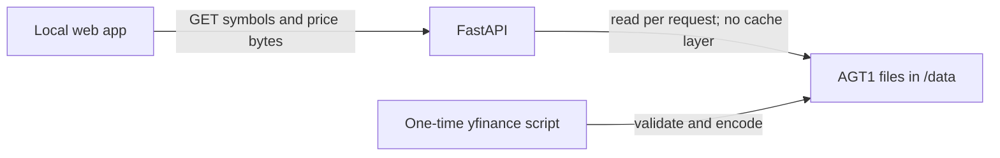

<!-- Purpose: explains the local API routes and data flow. Connects: browser requests to frozen price files. -->
# API

FastAPI serves frozen price files; strategy backtests continue to run in the browser. Uvicorn 0.54.0 is included only as the local ASGI server for the demo.



## Routes

- `GET /health` returns `{"status":"ok"}`.
- `GET /api/symbols` lists symbols whose files exist in `/data`.
- `GET /api/prices/{symbol}?from=YYYY-MM-DD&to=YYYY-MM-DD` returns `application/octet-stream` bytes. Either date is optional; both bounds are inclusive. `X-Bar-Count` reports the number of returned daily bars.

## Symbol names

Use the exact names returned by `/api/symbols`: the index is `^NSEI`; stock symbols are uppercase ticker names with the `.NS` suffix (for example, `RELIANCE.NS`). Preserve capitalization and punctuation in requests. The index maps to `NIFTY_50.agt1`; stock files omit `.NS` (for example, `RELIANCE.NS` maps to `RELIANCE.agt1`).

CORS allows only `http://localhost:5173` and `http://127.0.0.1:5173`. No backtest runs on this API, and no cache or database is used.

Run from the repository root in Windows PowerShell:

```powershell
api\.venv\Scripts\python.exe -m uvicorn app.main:app --app-dir api --host 127.0.0.1 --port 8000
```

Then open `http://127.0.0.1:8000/api/symbols` in a browser.
