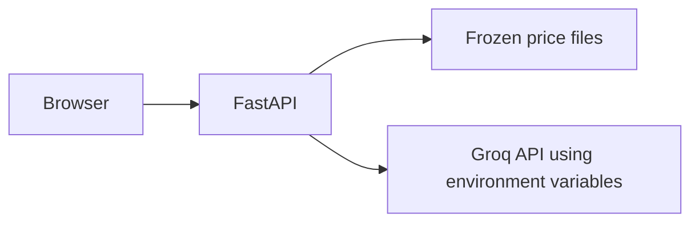

<!-- Purpose: documents the FastAPI service. Connects: browser requests to frozen data and the AI provider. -->
# API

FastAPI serves frozen price files and proxies AI requests; the backtest itself runs in the browser.

