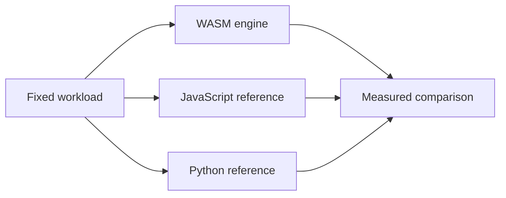

<!-- Purpose: documents benchmark plans and measured outputs. Connects: fixed workloads to reproducible timing results. -->
# Benchmarks

Benchmark results will be recorded only after measurements are run.

