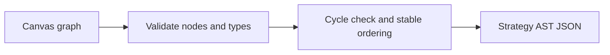

<!-- Purpose: documents the TypeScript compiler package. Connects: graph nodes to validated Strategy AST JSON. -->
# Compiler

This workspace package will validate strategy graphs and emit the JSON AST defined in `/spec`.

