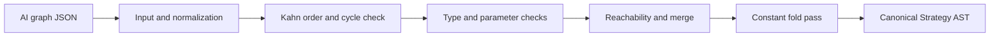

<!-- Purpose: documents the TypeScript compiler package. Connects: graph nodes to validated Strategy AST JSON. -->
# Compiler

This package accepts the plain graph format from `/spec/ai-graph-format.md` (node ids/types/params and from/to/port edges) and exports `compile(graph, config)`. It also exports `compileSource(source, config)`, the handwritten source-language frontend. Its result has the ordinary compile fields plus the lowered graph and a node-to-source-span map. React Flow objects are deliberately outside its public boundary. See `src/language/README.md`.

Run `pnpm --filter @algotrace/compiler test` and `pnpm --filter @algotrace/compiler typecheck` from the repository root. For exact output text, serialize `result.ast` with two-space JSON indentation and a final newline. The constant-fold pass is currently a no-op: v1 allows no constant-only math/comparison (AT-E010), and the other operations consume series, so no valid constant expression can be folded safely.

