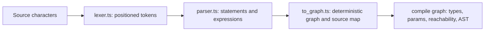

<!-- Purpose: explains the source-language frontend modules. Connects: character scanning to graph compilation. -->
# Strategy language frontend

The compiler's language frontend has three stages and no parser-library dependency:

`lexer.ts` scans one character at a time. It recognizes names, decimal numbers, quoted titles, symbols, comments, and line endings. Every token carries a 1-based line and end-exclusive columns; CRLF is one line break and a tab advances one column. The `#` comment marker is recognized only outside a quoted string.

`parser.ts` consumes tokens into a small syntax tree. It parses statements line by line and uses precedence climbing for expressions: each precedence level decides which operators bind more tightly. Comparisons are non-associative, so `a < b < c` is rejected. Recoverable syntax errors are collected in source order; an unterminated title is AT-S002.

`to_graph.ts` checks assignment order and uniqueness, rules, settings, and periods. It emits nodes in deterministic traversal order, reuses each price-field node, maps unary minus to zero minus the operand, and records a source span for every node. `compileSource()` then invokes the regular graph compiler, which remains the authority for graph types and engine AST validity.

The frontend is lexical and syntax analysis for the project: the lexer recognizes the vocabulary and positions, the parser checks grammatical structure and precedence, and graph lowering connects that syntax to the already documented graph language. See `/spec/strategy-language.md` and decisions 041–044.
