<!-- Purpose: explains the ordered compiler pass folder. Connects: AI graph input to canonical AST output. -->
# Compiler passes

Each module validates or transforms a single stage; `compile` stops on the first stage that reports errors. This makes error precedence predictable and keeps each rule easy to review.

```mermaid
flowchart LR
  Input[Validate graph and config] --> Normalize[Build connections and defaults]
  Normalize --> Kahn[Cycle check and topological order]
  Kahn --> Types[Check connections and value types]
  Types --> Params[Validate params]
  Params --> Reach[Remove unreachable nodes]
  Reach --> Merge[Merge duplicate computations]
  Merge --> Fold[Constant-fold boundary]
  Fold --> Lower[Lower to Strategy AST]
```

