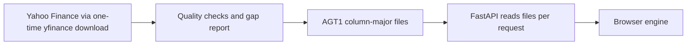

<!-- Purpose: records the frozen NSE files and their provenance. Connects: Yahoo Finance downloads to the binary API payloads. -->
# Frozen NSE data

## Provenance

- Download date: **2026-11-15**.
- Source: Yahoo Finance via yfinance, an unofficial data source, used once for this educational project.
- Requested history: daily bars from 2010-01-01 through the latest data available on the download date.
- Returned coverage: **2010-01-04 through 2026-11-13** for all 16 symbols.
- Adjustment: yfinance `auto_adjust=True`; open, high, low, and close are adjusted together for splits, bonus issues, and dividends. These historical prices therefore do not necessarily match the prices investors actually paid at the time. Whole-share counts and rupee charges in this project are computed using these adjusted prices. This is a known limitation to include in the final known-limitations document. Volume is preserved as returned.
- Tool versions: Python 3.13.6, yfinance 1.8.0, pandas 3.1.1.
- Format: little-endian `AGT1` as specified in [`spec/data-format.md`](../spec/data-format.md). Each filename maps one ticker to one binary file.
- Symbol format for the web app: the index is `^NSEI`; stock symbols are uppercase ticker names ending in `.NS` (for example, `RELIANCE.NS`). Keep this exact spelling and case in API requests. The index file is `NIFTY_50.agt1`; stock filenames remove the `.NS` suffix and add `.agt1` (for example, `RELIANCE.agt1`).

## Files

| Symbol | File | Bars |
| --- | --- | ---: |
| `^NSEI` | `NIFTY_50.agt1` | 4,142 |
| `RELIANCE.NS` | `RELIANCE.agt1` | 4,160 |
| `TCS.NS` | `TCS.agt1` | 4,160 |
| `HDFCBANK.NS` | `HDFCBANK.agt1` | 4,160 |
| `INFY.NS` | `INFY.agt1` | 4,160 |
| `ICICIBANK.NS` | `ICICIBANK.agt1` | 4,160 |
| `ITC.NS` | `ITC.agt1` | 4,160 |
| `SBIN.NS` | `SBIN.agt1` | 4,160 |
| `LT.NS` | `LT.agt1` | 4,160 |
| `BHARTIARTL.NS` | `BHARTIARTL.agt1` | 4,160 |
| `HINDUNILVR.NS` | `HINDUNILVR.agt1` | 4,160 |
| `AXISBANK.NS` | `AXISBANK.agt1` | 4,160 |
| `KOTAKBANK.NS` | `KOTAKBANK.agt1` | 4,160 |
| `MARUTI.NS` | `MARUTI.agt1` | 4,160 |
| `SUNPHARMA.NS` | `SUNPHARMA.agt1` | 4,160 |
| `ASIANPAINT.NS` | `ASIANPAINT.agt1` | 4,160 |

## Quality checks

The downloader checks non-finite values, non-positive OHLC prices, negative volume, `high < low`, and duplicate dates. It also removes junk holiday rows across stocks: a bar is flat when `abs(high-low) <= 1e-9 * max(abs(high), abs(low))` and `abs(open-close) <= 1e-9 * max(abs(open), abs(close))`; a date is removed only if every stock file that contains it has exactly zero volume and a flat bar. This treats tiny floating-point differences as rounding noise. The scan found 2014-10-15 as the additional qualifying date; together with 2014-04-24 and 2026-01-15, 45 rows total have been removed (3 from each of 15 stock files). No index rows were removed. There were no other qualifying dates in the files. Every output file was decoded and revalidated after regeneration. See [decision 026](../decisions/026-zero-volume-flat-bar-cleanup.md).

The downloader also reports weekday dates with no bar. After the three removals it finds 259 weekday candidates for `^NSEI` and 243 for each stock. Weekday gaps may be NSE holidays or source omissions; no full historical NSE holiday calendar was used to distinguish them. These dates are reported, not filled with invented prices.

## Index and stock date alignment

`^NSEI` has 4,142 bars, which is 18 fewer than each cleaned stock file (4,160), although the first and last dates are the same. Therefore any comparison between the index and a stock must join on the timestamp, never on bar position. On stock dates with no index bar, forward-fill the most recent index close. The engine's buy-and-hold benchmark uses the same stock as the strategy and is unaffected by this index alignment rule. See [decision 025](../decisions/025-align-index-stock-series.md).

The 21-date comparison before cleanup found two verified special Muhurat sessions on weekends, three zero-volume flat weekday dates removed above, eight ordinary weekday bars with nonzero volume and price ranges and no low-volume ambiguity, and eight other active weekday bars whose relative volumes do not establish a short session. The TCS values on 2014-10-15 differ by one ULP, but both OHLC differences are within the relative tolerance and the volume is zero in every stock; the rule therefore classifies and removes that date as junk. The eight active but volume-ambiguous dates remain; daily OHLCV alone does not prove whether they were short sessions or ordinary sessions with lower volume.

The Saturday `2020-11-14` and Sunday `2019-10-27` bars are non-flat with nonzero volume and match NSE Muhurat session dates ([2019 NSE circular](https://nsearchives.nseindia.com/content/circulars/CD42405.pdf), [2020 NSE circular](https://archives.nseindia.com/content/circulars/FAOP46231.pdf)); they are retained. The 2026-01-15 holiday is also listed by [NSE](https://www.nseindia.com/resources/exchange-communication-holidays/).

## Limitations

This is a list of today's large companies and the current NIFTY 50 index history. It has **survivorship bias**: companies that left the index or failed are not represented. The sample is not a point-in-time historical index membership list.

yfinance is an unofficial source and was used once for educational purposes. Frozen files make local demonstrations repeatable, but they are not an authoritative market-data record. Re-running `api/scripts/download_nse.py` replaces the files with a new snapshot.

## Rebuild the snapshot (Windows PowerShell)

From the repository root, after installing `api/requirements.txt` into `api\.venv`:

```powershell
api\.venv\Scripts\python.exe api\scripts\download_nse.py
```


