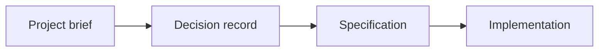

<!-- Purpose: explains the project decision-record folder. Connects: design choices to the brief and implementation. -->
# Decisions

Each numbered record captures a design choice, its beginner-level reason, trade-offs, and a short interview answer.

Records 041–044 cover the handwritten strategy lexer/parser, the v1 language design, source maps, and lowering unary minus through existing graph nodes.
