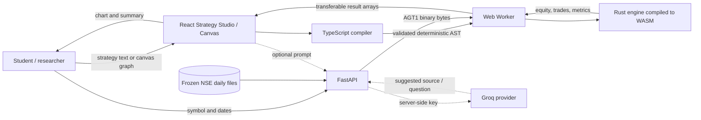

<!-- Purpose: a plain-language, end-to-end project and viva guide. Connects the project brief, specifications, implementation, test evidence, and presentation. -->
# AlgoTrace: complete project and viva guide

**Prepared:** 26 November 2026  
**Project:** AlgoTrace — browser-based NSE equity strategy backtesting  
**Students:** Yash Raj (BTECH/25143/23) and Navyansh Vyas (BTECH/25172/23)  
**Guide:** Dr. Abhishek Tiwari, Assistant Professor

This guide explains what the project does, how its parts work together, what has been tested, what remains limited, and how to present it. It is written as a study document: learn the ideas and explain them in your own words rather than memorizing every sentence.

## 1. The project in one minute

AlgoTrace is a local-first educational application for designing and backtesting long-only strategies on daily NSE equity data. A user can write a small strategy in a plain-text language, build one with a visual node canvas, or try the quick demonstration. The compiler checks the strategy and turns it into a deterministic intermediate representation. A Rust backtesting engine compiled to WebAssembly runs inside a browser worker. FastAPI supplies validated historical price bytes and provides a protected server-side route for optional AI assistance. The application reports trades, charges, equity, and performance metrics, while keeping its assumptions explicit and testable.

It is a research and learning tool. It is not a broker, a live trading system, investment advice, or evidence that a strategy will earn money in the future.

## 2. What problem it addresses

Backtests can be misleading when a program uses future information, assumes fractional shares, ignores charges, fills an order at a price that was not available, or uses inconsistent rules between tools. A student also needs to explain how a strategy moved from an idea to executed trades.

AlgoTrace addresses this by giving strategy design, compiler validation, simulation, costs, metrics, and the data format written rules. It uses the same Rust engine for native tests and browser execution, keeps data frozen for repeatable examples, and compares selected results against vectorbt. The visual canvas and text language both feed the compiler rather than implementing separate trading logic.

## 3. Users and main flows

### Strategy Studio

The Studio is the front door. The user selects a symbol and date range, starting capital, and whether to apply the Zerodha-style delivery preset. They edit a strategy in a text area. After a short pause the compiler checks it and shows beginner-friendly errors at source lines. The Graph tab previews the generated graph read-only. Run Backtest compiles again, fetches AGT1 bytes from the local API, and sends the work to the browser worker. Results include final equity, total return, closed trade count, charges, runtime, and an equity chart. The assistant can suggest or repair strategy-language source, but it does not execute a run; the user presses Run.

### Visual canvas (advanced)

The canvas lets a user place typed operation nodes and connect their ports. The compiler's own compatibility rules block invalid connections. The user can edit node parameters, use templates, lay out the graph, undo or redo, delete or duplicate nodes, and save or load graph JSON. Compiler errors and warnings are attached to the relevant node or edge where possible. The canvas input is the graph format in `/spec/ai-graph-format.md`, not React Flow's internal object format.

### Quick demo

The earlier thin-slice results page remains available as a compact demonstration of fetching a symbol, running the existing worker/WASM pipeline, and viewing results.

## 4. System design



### Component responsibilities

| Part | Responsibility | What it deliberately does not do |
|---|---|---|
| React/Vite web app | Editor, canvas, settings, charts, user interaction | It does not calculate trades itself |
| TypeScript compiler | Validates graph/source, reports diagnostics, emits canonical AST | It does not fetch prices or simulate a portfolio |
| Web Worker | Keeps CPU work away from the user interface; owns WASM calls | It does not decide strategy semantics |
| Rust engine | Reads numeric series, evaluates nodes, simulates fills, charges fees, computes metrics | It does not call an API or AI provider |
| FastAPI | Health/symbol/price endpoints and the optional AI proxy | It does not run the backtest or hold a database/cache |
| Frozen data | Repeatable daily price history in AGT1 files | It is not a live feed or a complete point-in-time universe |
| Reference scripts | Compare the engine against vectorbt for selected strategies | They are not a second production simulator |

Data travel as binary arrays where practical. The browser fetches a symbol file once and transfers the `ArrayBuffer` to the worker. The worker copies those bytes once into allocated WASM memory, then the engine reads prices in place; result arrays are exposed from WASM and transferred back. Typed-array views must be recreated after any call that could grow WebAssembly memory because growth can detach or replace the underlying JavaScript buffer. “Zero-copy” is therefore limited: it means the price arrays are not repeatedly copied during engine evaluation, not that no copy occurs at the fetch-to-WASM boundary.

## 5. Strategy language and compiler

### Example

```text
strategy "SMA crossover"
fast = sma(close, 10)
slow = sma(close, 30)
buy when crosses_above(fast, slow)
sell when crosses_below(fast, slow)
```

This opens a long position after the fast average crosses above the slow average, and schedules an exit after it crosses below. Signals use completed bar data; the order fills at the next bar's open.

### Language rules to know

- One statement per line; blank lines and `#` comments are ignored. Both full-line and trailing comments work; `#` inside the quoted title is literal text.
- The optional `strategy "Name"` title must be the first nonblank, noncomment line.
- Names start with a letter or underscore and then use letters, digits, or underscores. Names are case-sensitive and must be assigned before use, exactly once. Keywords, price fields, and function names cannot be assignment names.
- Price fields are `open`, `high`, `low`, `close`, and `volume`.
- Functions are `sma(x,n)`, `ema(x,n)`, `rsi(x,n)`, `delay(x,n)`, `crosses_above(a,b)`, and `crosses_below(a,b)`. Periods are integer literals within the node specification ranges.
- Operators: `+ - * /`, `>` and `<`, `and`, `or`, `not`, parentheses, and unary minus. There is no `>=`, `<=`, or equality operator in v1. Comparisons do not chain.
- Exactly one `buy when` and one `sell when` rule are required. Assignments, rules, and settings can otherwise be interleaved after the title, as long as assignment-before-use holds.
- Optional settings are `size N%` (1–100; defaults to 100%), `stop_loss N%` (0.1–50%), and `take_profit N%` (0.1–500%). The percent sign is required. Omitting a stop or target disables that feature.
- Positions in source spans are 1-based line and column. A span ends just after its last character; a tab counts as one column. LF, CRLF, and a missing final newline are supported.
- Unary minus becomes a subtraction node whose left input is constant zero. This keeps the AST within the existing node vocabulary.

### Compiler pipeline

The public compiler functions are `compile(graph, config)` and `compileSource(source, config)`. The source compiler lexes characters into tokens, parses tokens according to precedence, creates a source map, converts the syntax tree into the existing graph format, then invokes the same graph compiler. In broad order, graph compilation validates input structure, normalizes connections/defaults, detects cycles and orders nodes, type-checks with number-to-series broadcasting, validates parameters, removes unreachable nodes with a warning, merges duplicate computations, folds constants, and lowers the graph to the canonical AST.

Kahn's topological algorithm emits dependencies before users. Ties select the smallest node ID by ordinary string comparison. Duplicate computations are merged only when op, params, and already-normalized input connections match; the smallest ID survives. `a + b` and `b + a` are not considered duplicates. AST JSON has stable key order, two-space indentation, a trailing newline, and no timestamps. These rules make the same input produce byte-identical output and simplify golden tests and caching.

The compiler reports errors from the earliest failing stage, sorts them deterministically, and does not continue after broken structure. Main graph error families are AT-E001 to AT-E010; AT-W001 is an unreachable-node warning. The source lexer/parser has AT-S001 to AT-S006 for unexpected characters/tokens, unknown names/functions, assignment order/duplicates, missing or repeated rules/settings, and function argument/period errors. Beginner hints explain what to change. The source map links graph node IDs back to source spans so compiler diagnostics can be shown in the editor.

### Node and type model

The graph contains PRICE and CONSTANT sources; SMA, EMA, RSI and DELAY operations; arithmetic (ADD, SUB, MUL, DIV); comparisons (GT, LT, CROSSES_ABOVE, CROSSES_BELOW); boolean operations (AND, OR, NOT); and one STRATEGY sink. Values are typed as `Number`, `Series`, or `BoolSeries`. A scalar number can broadcast across a time series, for example `close > 10`, but a boolean series cannot be passed as a numeric indicator input. Division by zero yields an invalid numeric value according to engine rules; it does not silently create an infinite trade signal.

## 6. Rust engine and backtest semantics

### Indicators and evaluation

- SMA uses the trailing `period` values and first becomes valid at index `period - 1`.
- EMA is seeded with that first SMA, then uses the standard recursive exponential update; it also first becomes valid at `period - 1`.
- RSI uses Wilder smoothing and first becomes valid at index `period`. If average loss is zero, RSI is 100; if average gain and loss are both zero, RSI is 50.
- Crossovers are false unless both series are valid on the previous and current bars. DELAY(n) is invalid (or false for boolean values) for its first n bars.
- Warm-up/invalid values cannot trigger a trade. Price bars are validated before execution.

### Event order and fills

1. Indicators and entry/exit conditions are computed using data through the close of bar `t`.
2. A signal on bar `t` schedules an order for the open of bar `t+1`; a signal on the final bar cannot create a fill because no next bar exists.
3. Scheduled orders fill at the next open, with adverse slippage for market-style buys and sells. A buy uses whole shares only. The engine sizes the purchase so shares plus estimated buy costs do not exceed available cash. There is no short selling, leverage, or stacking of positions.
4. Once open/scheduled orders are processed on a bar, intrabar stop and target checks apply to a position still held. If both stop and target are hit in the same bar, stop wins. A stop is market-style and receives adverse slippage; on a gap through the stop, the open is used as the reference before slippage. A take-profit is a limit-style exit with no slippage and fills at the greater of the open or target.
5. G15: if a signal exit was scheduled for that bar, it fills at the open before intrabar stops and wins the overlap. If that open is already below the stop, it is still an open fill with slippage and the reason is `signal`. If no scheduled exit exists, the normal stop applies.
6. If forced close is enabled, a remaining position sells at the last close less sell slippage, pays normal sell costs, and has reason `end_of_data`. Otherwise it remains open and is valued at last close without an exit fee. The open position is excluded from closed-trade count, win rate and profit factor.

The simulator records fills/trades and equity over time. No prices or quantities are rounded inside the engine: calculations use `f64`, including fractional prices and charges. Whole shares are the exception for quantity. Display values use two decimals. Charges are calculated per fill. Required test tolerances are Rs 0.01 for charges and `1e-6` for other values.

### Cost model

Two bundled presets are available: `zero_costs` and `zerodha_equity_delivery`. A custom preset means the caller supplies a preset object; it is not a bundled preset name. Percentage fields are percentage points: `0.1` means 0.1%, converted to a fraction by the engine at configuration load. Rates and flat charges must be finite and nonnegative.

The Zerodha-style educational delivery preset includes brokerage, STT on buys and sells, exchange transaction charge, SEBI charge, stamp duty on buys, GST on applicable charges, and DP charge on a sell. The spec's sanity calculation—buying Rs 100,000 and later selling Rs 100,000—totals Rs 237.8212. DP charge applies only on sells. The preset is stored as data in `engine/config/cost_presets.json`, not embedded as scattered constants.

These are modeled charges, not a promise that a broker invoice will be identical. Rates can change, product categories differ, and the dataset itself is adjusted. The preset is an explicit educational approximation.

### Portfolio metrics

The engine reports equity/return and risk/trade summaries. Annualization uses the configured `trading_days_per_year` everywhere (default 252). CAGR uses the observed bar-period length and annualization setting. Daily risk-free rate is annual risk-free rate divided by trading days per year. Sharpe is the mean daily excess return divided by sample standard deviation, multiplied by the square root of trading days per year. Sortino uses the same daily target and the square root of the mean squared negative deviations over all days, then annualizes by the same square-root factor. Maximum drawdown is measured from an equity peak. Drawdown length is the longest run from a peak until the first recovery bar, in bars; if not recovered, it runs through the final bar.

Undefined metrics are JSON `null`, never NaN: Sharpe/Sortino when too few returns or zero denominator; win rate and average trade with no closed trades; profit factor when gross losses are zero. The interface displays `n/a`. The buy-and-hold benchmark uses the same symbol and stock series, so it is not affected by the index/stock calendar mismatch.

## 7. Data, API, and reproducibility

### Frozen dataset

The repo contains one AGT1 file for NIFTY 50 (`^NSEI`) and 15 stocks (`RELIANCE.NS`, `TCS.NS`, `HDFCBANK.NS`, `INFY.NS`, `ICICIBANK.NS`, `ITC.NS`, `SBIN.NS`, `LT.NS`, `BHARTIARTL.NS`, `HINDUNILVR.NS`, `AXISBANK.NS`, `KOTAKBANK.NS`, `MARUTI.NS`, `SUNPHARMA.NS`, `ASIANPAINT.NS`). Symbol names preserve uppercase letters and Yahoo Finance's `.NS` suffix; the index uses `^NSEI` without `.NS`. The snapshot was downloaded once from yfinance, covering 2010-01-04 through 2026-11-13. Each stock has 4,160 bars after cleaning; NIFTY 50 has 4,142 bars.

The downloader uses `auto_adjust=True`, adjusting historical open, high, low and close consistently for splits, bonuses, and dividends. This means values do not necessarily equal the market prices paid at the time. Whole-share quantities and rupee charges are consequently computed on adjusted prices. The current set of large companies creates survivorship bias: it does not represent the historical index constituents as they changed. yfinance is unofficial and was used once for this educational frozen snapshot. Weekday gaps are recorded, not filled. Where index data is compared with a stock, join on timestamps and forward-fill the index close on stock dates with no index bar; never align by bar number.

The repeatable junk-bar cleaning rule: a stock bar is flat if `high - low` and `open - close` are each within relative tolerance `1e-9`; a date is a junk holiday bar when volume is zero and the bar is flat in every stock file containing that date. That shared date is removed from stock files. The known removed dates are 2014-04-24, 2014-10-15, and 2026-01-15.

### AGT1 binary format

The file starts with a 16-byte header: four ASCII bytes `AGT1`, a little-endian `u32` bar count, then eight reserved bytes. It is followed by six little-endian `f64` column arrays in order: timestamp (Unix seconds), open, high, low, close, volume. Columnar layout supports direct typed-array access without decoding every bar into an object. Loader checks include file length/magic, finite values, positive OHLC prices, high not below low, nonnegative volume, and strictly increasing timestamps. Invalid input is rejected before a backtest starts.

### FastAPI

- `GET /health`: local service health.
- `GET /api/symbols`: available symbols.
- `GET /api/prices/{symbol}?from=&to=`: AGT1 binary bytes, `application/octet-stream`, with bar count header.
- `POST /api/generate`: optional assistant request; API key remains server-side, not in browser code.

CORS is limited to the local Vite origins `http://127.0.0.1:5173` and `http://localhost:5173`. There is no Redis or PostgreSQL and no cache layer. Uvicorn is only the local ASGI server. API errors are converted to beginner-readable messages; provider logs avoid secrets. `api/scripts/check_groq.py` makes one small diagnostic request and prints whether settings are present, key length, HTTP status, safe provider error details, and a failure classification. It never prints the key. It has not established that a real provider call succeeds for a particular account/model; fake-provider tests do not prove external connectivity.

Run the diagnostic from the repo root with:

```powershell
api\.venv\Scripts\python.exe api\scripts\check_groq.py
```

## 8. Validation and evidence

### Reference comparison

Three signals are used: SMA(10)/SMA(30) crossover; RSI(14) crossing below 30 to enter and above 70 to exit; and close above/below SMA(20) with a 10% stop. Both Rust and vectorbt receive identical precomputed entry and exit signals, zero costs and slippage, Rs 100,000 initial cash, long-only direction, no stacking, whole-share sizing, and next-bar-open fills. In vectorbt the prices use the open, the signal series is shifted one bar, `size=1.0` with percent sizing, granularity 1, partial sizing allowed, cash sharing disabled, accumulation disabled, and long conflicts ignored. Stops apply only to the third strategy.

The project checks trade dates and share quantities exactly and compares prices/equity at relative tolerance `1e-6`. Eight of nine full-history pairs match. The sole named exception is SBIN's stop strategy on 2020-03-02 (bar 2502): G15 says the already-scheduled signal exit at the open wins; vectorbt triggers its intrabar stop first. Rust exits at open Rs 281.8838664; vectorbt exits at stop Rs 262.9133210. Equity at the close is Rs 228,917.01 for Rust and Rs 213,512.93 for vectorbt. The SBIN stop comparison is therefore only claimed through bar 2501. A per-bar stop-array attempt did not cleanly enforce the precedence, so no hack was introduced. Decision 028 records the exception.

For the main RELIANCE.NS SMA crossover reference, there are 4,160 bars and final equity is Rs 291,218.02995796944 with zero charges and no forced close. The reference has 79 trade records, of which 78 are closed; the last position is open. On TCS.NS the three strategy trade counts are 77, 16, and 229. The corresponding RELIANCE.NS counts are 79, 17, and 236. The counts refer to reference trade records for the tested strategies; the UI explicitly distinguishes closed trades from open records.

The separate 20-bar worked fixture has final equity Rs 1,250, one closed trade, and Rs 0 charges.

### Test commands and their purpose

| Command | What it checks |
|---|---|
| `cargo fmt --manifest-path engine\Cargo.toml -- --check` | Rust formatting |
| `cargo clippy --manifest-path engine\Cargo.toml --all-targets --all-features -- -D warnings` | Rust linting with warnings denied |
| `cargo test --manifest-path engine\Cargo.toml` | Rust unit, integration, fixture, stop, no-look-ahead, and property checks |
| `pnpm test` | TypeScript compiler/web unit tests, including language lexer/parser and fuzz coverage |
| `pnpm typecheck` | Strict compiler and web TypeScript checks |
| `pnpm test:wasm` | Node integration tests using the actual built WebAssembly package; includes strategy-language examples and six reference trade-count checks |
| `api\.venv\Scripts\python.exe -m pytest api\tests` | API route, binary, quality, assistant/error mapping tests (provider is faked) |
| `pnpm --filter @algotrace/web test:e2e` | Local Playwright browser flows, including the editor, canvas, Studio, and assistant mock paths |
| `reference\.venv\Scripts\python -m pytest reference\tests` | Reference comparator/regression scripts |

The Playwright suite is intentionally local-only and not in CI because it needs the Python environment and frozen data. GitHub Actions runs Rust, TypeScript (including real WASM), and Python jobs. Test coverage demonstrates software behavior under known fixtures; it does not prove future investment performance or live provider availability.

## 9. Start and use the project on Windows

From PowerShell in the repository root, install the root workspace and the local API dependencies. If the virtual environment has not been created yet:

```powershell
pnpm install
python -m venv api\.venv
api\.venv\Scripts\python.exe -m pip install -r api\requirements.txt
pnpm build:wasm
```

Open one PowerShell window and start FastAPI:

```powershell
api\.venv\Scripts\python.exe -m uvicorn app.main:app --app-dir api --host 127.0.0.1 --port 8000
```

Open a second PowerShell window in the repo root and start Vite:

```powershell
pnpm --filter @algotrace/web dev
```

Open `http://127.0.0.1:5173`. The Studio defaults to RELIANCE.NS. If API prices cannot load, verify the API window is running. To use the assistant, configure `GROQ_API_KEY` and `GROQ_MODEL` in the ignored `api/.env` and restart FastAPI. Never add the key to source control or share it in screenshots/logs.

For a presentation demo, build WASM before starting Vite and ensure the frozen data/API are available. Select “Moving-average crossover”; switch charges off to reproduce the reference output (or leave Indian charges on to demonstrate cost impact). Run the strategy and point out the closed-trade count separately from the open final position.

## 10. Known limitations and future scope

### Current limitations

- Data is daily and adjusted, not point-in-time unadjusted execution data. The universe is today's selected large companies, causing survivorship bias. yfinance is unofficial, and weekday gaps are not synthesized.
- The backtester is long-only and whole-share, with a single active position and no stacking. It does not model intraday order books, partial fills, latency, market impact, liquidity constraints, taxes in every possible product category, corporate actions as cash flows, or broker-specific live execution.
- It is local-first, not a hosted multi-user service. There is no user database, Redis, authentication system, or live broker integration.
- vectorbt cannot reproduce the engine's G15 stop-versus-scheduled-signal precedence on one SBIN bar; the comparison is transparently limited through the prior bar.
- AI requires a working Groq key/model/network. Its behavior is tested with fakes and offline examples; tests do not make live provider calls. The diagnostic script is the safe manual check. AI suggestions remain untrusted until the compiler accepts them, and the user decides when to run.
- Some future presentation ideas—larger AI evaluation set, measured speed study, live market feed, strategy export, public hosting, richer report export, or more chart/heatmap work—are future scope unless the source code and project checklist explicitly say otherwise. Do not claim them as completed features.

### Future work that can be defended

1. Use point-in-time constituent membership and a licensed, audited source to reduce survivorship and source-quality issues.
2. Add intraday data only after specifying timestamps, session boundaries, corporate actions, and fill assumptions.
3. Expand cost presets with version/date metadata and broker-reviewed calculations; add explicit taxes/charges for more instruments.
4. Build a larger AI evaluation set measuring compile rate, repair rate, semantic fidelity, and unsafe suggestions; retain user confirmation before execution.
5. Add reproducible exports for strategy, configuration, data version, trades, and metrics.
6. Run a controlled performance study for native Rust versus WASM and document dataset size, hardware, warm-up, and repetitions.
7. Add a governed method for future data refreshes without silently changing the frozen reference snapshot.

## 11. Presentation: slide-by-slide explanation and speaking points

Use these as a script outline. Point to the diagram or numbers on the slide as you speak; do not read dense slide text word-for-word. At a normal pace, allow roughly 30–60 seconds per content slide, with more time for the DFD and validation result.

### Slide 1 — Title

**Purpose:** Identify the project, presenters, guide, and review date.  
**Speaking points:** “Good morning. We are presenting AlgoTrace, an educational NSE equity strategy backtesting platform. Our focus is not only producing a backtest, but making the strategy rules, data flow, costs, and validation explainable. We are Yash Raj and Navyansh Vyas, guided by Dr. Abhishek Tiwari.”  
**Transition:** “I’ll first outline what the presentation covers.”

### Slide 2 — Contents

**Purpose:** Give the panel a map of the talk.  
**Speaking points:** “We will move from the problem and objectives to the dataset and architecture, then show how we checked the results, what we contributed, and what remains future work.”  
**Transition:** “The core idea is to make backtesting rules explicit and repeatable.”

### Slide 3 — Introduction

**Purpose:** State the project aim and system boundary.  
**Speaking points:** “A user can write a strategy in our small language or build a graph. The TypeScript compiler validates it. The Rust engine runs in WebAssembly in a worker, while FastAPI serves frozen prices and proxies optional AI assistance. The browser does the backtest. The AI cannot bypass compilation or start a run.”  
**Emphasize:** A single engine semantics path serves both the text and canvas workflows.  
**Transition:** “That boundary is a response to specific weaknesses in simple backtests.”

### Slide 4 — Problem statement and objectives

**Purpose:** Connect the motivation to concrete project goals.  
**Speaking points:** “A result is not trustworthy if the test looks ahead, fills at an impossible price, ignores charges, or hides undefined metrics. Our goals were to define those rules, build a usable strategy interface, and validate a representative subset against an established reference tool.”  
**Transition:** “The reliability of those tests also depends on understanding the input data.”

### Slide 5 — Dataset

**Purpose:** Explain the frozen dataset and its caveats.  
**Speaking points:** “We froze daily bars for the NIFTY 50 index and 15 selected stocks from 2010 to November 2026. The files are checked and stored in a compact binary columnar format. Yahoo Finance auto-adjusts open, high, low, and close together. This is useful for consistent educational history but does not equal the prices paid at the time. The chosen present-day companies create survivorship bias, and the source is unofficial.”  
**Emphasize:** “We disclose these limitations rather than presenting the output as a live-market or investment result.”  
**Transition:** “Here is how a strategy and those data move through the system.”

### Slide 6 — DFD and methodology

**Purpose:** Show actors, processes, data stores, and the simulation sequence.  
**Speaking points:** “The user enters code or a graph in Strategy Studio. The compiler validates and creates a deterministic AST. The price file comes from the local API, then a worker passes it to the Rust/WASM engine. Results return as arrays and appear in the chart. Optional AI goes through FastAPI so the key stays off the browser; its output is compiler-checked.”  
“Inside the engine, indicators are computed, signals use bar t, orders fill at the next open, stops and costs are applied according to the specified event order, then equity and metrics are calculated.”  
**Emphasize:** “The web app does not contain a second copy of the trading simulator.”  
**Transition:** “We checked this design with hand-computed cases and an independent library.”

### Slide 7 — Results and validation

**Purpose:** Show quantitative checks and be candid about the exception.  
**Speaking points:** “For the RELIANCE moving-average crossover, the reference run ends at Rs 291,218.03 with zero costs and no forced close. There are 79 records but 78 closed trades because one position is still open. The three strategy trade counts match on RELIANCE and TCS. Eight of nine full comparisons match vectorbt; the one SBIN stop case differs at bar 2502 because our written G15 rule gives a scheduled signal exit priority over an intrabar stop. We compare SBIN only through bar 2501.”  
“A separate 20-bar hand-worked fixture finishes at Rs 1,250 with one closed trade and no costs.”  
**Emphasize:** Explain the G15 rule before a panel asks why two tools differ.  
**Transition:** “The value of this project is the combination of usable authoring and auditable rules.”

### Slide 8 — Contributions

**Purpose:** Summarize what was actually built.  
**Speaking points:** “The main contributions are a typed strategy language and compiler, a visual graph editor using that compiler, a Rust engine shared by native tests and WebAssembly, a frozen data/API boundary, and reference/regression tests. We also wrote specifications and decision records so assumptions are reviewable.”  
**Transition:** “I’ll conclude with the boundary of our claims and the next steps.”

### Slide 9 — Conclusion and future scope

**Purpose:** State outcomes, limitations, and credible next work.  
**Speaking points:** “AlgoTrace demonstrates a repeatable educational backtest workflow with explicit timing, share sizing, costs, and metric rules. It does not establish that a strategy is profitable, does not trade live, and uses adjusted survivorship-biased data. Next we would improve point-in-time data, expand cost coverage, evaluate AI systematically, and benchmark performance under controlled conditions.”  
**Transition:** “These are the sources behind the implementation and checks.”

### Slide 10 — References

**Purpose:** Show the foundations used.  
**Speaking points:** “The primary behavioral source is our checked-in specification. Implementation and comparison scripts are in the repository. We used vectorbt as a comparison yardstick and cited the relevant data, framework, and provider documentation. Where tool behavior did not match our written rule, we recorded the exact exception.”  
**Transition:** “Thank you. We welcome questions.”

### Slide 11 — Thank you

**Purpose:** Close and invite questions.  
**Speaking points:** “Thank you for your time. We are happy to explain the event order, compiler, data checks, or the comparison exception in more detail.”

## 12. Professor cross-questioning: likely questions and strong answers

Answer directly first, then expand only if asked. If a feature is not built, say so plainly; distinguish implementation evidence from future scope.

### Project purpose and architecture

**Q1. What is AlgoTrace?**  
A local-first educational NSE daily-bar backtesting app. Users author a strategy in text or a graph; a shared compiler and Rust/WASM engine validate and simulate it.

**Q2. What is the main problem you are solving?**  
Making backtest assumptions explicit and repeatable: signal timing, fill timing, whole-share sizing, costs, stops, metrics, and data quality.

**Q3. Why does the engine run in WebAssembly?**  
It lets the browser call the same Rust logic tested natively, while keeping the compute local and responsive. The worker protects the UI from a long calculation.

**Q4. Why Rust for the engine and TypeScript for the compiler?**  
Rust gives a strongly typed, testable native core that compiles to WASM. TypeScript integrates naturally with the web app and is suitable for validating graphs and mapping source positions.

**Q5. Why use FastAPI if the backtest runs in the browser?**  
FastAPI serves frozen binary data and keeps the optional Groq credential on the server. It is not the backtesting engine and has no database/cache layer.

**Q6. What does “local-first” mean here?**  
The UI and simulation run locally in the browser, and for the demo the API is a local service. Optional AI calls leave the machine through FastAPI to Groq; without that option, the core backtest can run locally using the frozen data.

### Language and compiler

**Q7. What is an AST?**  
An abstract syntax tree is a structured representation of a program after syntax has been understood. Here the compiler lowers the validated strategy graph to a stable format the engine can execute.

**Q8. Why have both a text language and a canvas?**  
They are two ways to author the same graph semantics. Both are checked by the same compiler, so they do not create separate execution rules.

**Q9. Why hand-write the lexer and parser instead of using a parser library?**  
The language is deliberately small. A hand-written implementation makes tokenization, precedence, source locations, and error recovery easy to demonstrate and avoids a dependency. It also gives us direct control of beginner-facing diagnostics.

**Q10. What is lexical analysis?**  
It scans characters and groups them into tokens such as identifiers, numbers, operators, keywords, and punctuation, while retaining line and column positions.

**Q11. What is syntax analysis?**  
It checks the token sequence against the grammar and builds expression structure using precedence. For example, multiplication binds more tightly than addition, while `and` binds more tightly than `or`.

**Q12. How does the compiler make output deterministic?**  
It orders nodes with Kahn's algorithm and chooses the lexicographically smallest ready ID; merges exact duplicate computations with the smallest ID surviving; writes keys in specified order; and uses fixed indentation and newline behavior. There are no timestamps.

**Q13. What does Kahn's algorithm do?**  
It repeatedly emits nodes with no remaining dependencies, then releases their dependent nodes. If nodes remain but none are ready, the remaining dependency graph contains a cycle.

**Q14. What is type broadcasting?**  
A scalar `Number` can be applied element-by-element to a `Series`, such as comparing every close price with 100. It does not make a boolean series a valid numeric price input.

**Q15. How are compiler errors tied to a line in the code?**  
The source conversion records a mapping from generated graph node IDs to source line/column spans. When the graph compiler reports a node diagnostic, the Studio uses that map to highlight the original source location.

**Q16. What does an unreachable-node warning mean?**  
A computation exists in the graph but does not contribute to the strategy sink, so it has no effect on a run. The compiler removes it and reports AT-W001.

**Q17. Why are commuted expressions not merged?**  
The v1 duplicate rule is exact input-port equality after prior merges. `a+b` and `b+a` remain separate; adding algebraic equivalence would require more reasoning about floating-point and side effects than the current compiler needs.

**Q18. What happens with unary minus?**  
It is represented using existing nodes as `0 - x`. This avoids introducing an extra engine operation and is covered by the language design decision.

### Engine and trading assumptions

**Q19. How do you avoid look-ahead bias?**  
Signals at bar t use values available through that bar's close; they can only schedule an order for bar t+1's open. A regression test changes later prices and checks earlier signals, orders, and equity remain unchanged.

**Q20. Why do you fill at the next bar's open?**  
The signal depends on the completed bar close. Filling at that same close would assume the strategy could compute the close-based signal and transact at the already-finished close. The next open is the explicit conservative convention used by the spec and reference comparison.

**Q21. What if a signal occurs on the last bar?**  
It creates no order because the next bar does not exist. Any existing position remains open and is valued at the last close unless force-close is enabled.

**Q22. Why only whole shares?**  
Whole-share quantities better reflect ordinary equity trading and are an explicit rule. The buy quantity is chosen so the estimated purchase plus charges does not exceed cash.

**Q23. Can the simulator go short or hold stacked positions?**  
No. It is long-only and uses one active position without stacking in the v1 rules.

**Q24. What happens if there is not enough cash for a sell fee?**  
The run is rejected before it could produce negative cash. The cash invariant is tested.

**Q25. What happens if stop-loss and take-profit both fall inside one bar?**  
The stop takes priority because daily OHLC does not reveal the intrabar path. Choosing the more conservative outcome avoids inventing a favorable sequence.

**Q26. Explain the scheduled-signal/stop overlap (G15).**  
Scheduled open orders happen first. If a signal exit and stop trigger on the same bar, the signal exit fills at the open with market-style slippage and reason `signal`. If no exit was scheduled, the stop rule applies. This explicit ordering is the source of the one vectorbt exception.

**Q27. How are end-of-data positions handled?**  
By default, they remain open, are marked at the last close, pay no exit costs, and are excluded from closed-trade metrics. With forced close, they sell at the last close after sell slippage and charges, with exit reason `end_of_data`.

**Q28. Why does DELAY produce invalid values at the start?**  
There is no prior value for the first n bars. Representing the warm-up as invalid prevents the engine from pretending a delayed signal existed before its history was available.

### Data, charges, and metrics

**Q29. What is AGT1?**  
Our simple little-endian columnar binary format: a 16-byte header followed by six `f64` arrays for timestamp, open, high, low, close, and volume. It allows compact transfer and predictable layout.

**Q30. Why use columns instead of bar objects?**  
Column arrays make the data compact and map naturally to numeric typed arrays in WebAssembly. The loader can expose views over the byte layout rather than allocating one object per bar.

**Q31. What quality checks happen before a run?**  
The loader checks the AGT1 structure and bar count/length, finite values, positive OHLC, high >= low, nonnegative volume, and strictly increasing timestamps. The downloader separately checks missing/gap dates, duplicates, and zero/negative or invalid OHLC and applies the documented zero-volume flat-bar rule.

**Q32. What does `auto_adjust=True` mean?**  
yfinance adjusts historical open, high, low, and close consistently for splits, bonuses, and dividends. It helps form a continuous adjusted series, but the historical values differ from actual transaction prices. Our whole-share and charge math therefore runs on adjusted prices, a known limitation.

**Q33. What is survivorship bias in this dataset?**  
The stock set reflects today's selected large companies, not every company that belonged to the index at every historical date. Failed, delisted, or replaced companies are underrepresented, which can make historical results look too favorable.

**Q34. Why are there missing weekdays?**  
Many are exchange holidays, but the snapshot also has differences between index and stock calendars. We preserve actual rows rather than inventing bars. Cross-series index/stock work aligns by timestamp and forward-fills the index close when required; it never pairs bars by array position.

**Q35. Why does the index have fewer rows?**  
The frozen index file has 4,142 bars while each cleaned stock has 4,160. Therefore, any combined index/stock comparison must join timestamps and use the specified forward-fill rule. The built-in buy-and-hold benchmark uses the same stock and is unaffected.

**Q36. How are costs represented?**  
The preset is data. It contains percentage-point rates and flat charges by side/type. Each fill computes its applicable charges, including DP charge only on sells. A custom preset is an object supplied by the caller. Invalid negative or non-finite values are rejected.

**Q37. What proves the charge calculation is plausible?**  
The checked-in cost spec has a known round-trip sanity fixture: buy Rs 100,000 and sell Rs 100,000 under the delivery preset, yielding Rs 237.8212. The engine test allows 0.01 rupee tolerance and separately verifies DP charge only applies on sells.

**Q38. Why are percentages called percentage points?**  
To remove ambiguity: a field value of `0.1` means 0.1%, i.e. fraction `0.001`. The engine converts percent points to fractions once while loading configuration.

**Q39. Why can a metric be null?**  
Some metrics have no mathematical definition for a particular run. For example, Sharpe is undefined with fewer than two returns or zero standard deviation; win rate is undefined with no closed trades. We serialize null and show `n/a`, rather than NaN or a misleading zero.

**Q40. What does Sortino measure here?**  
It measures average return above the daily risk-free target relative to downside deviation, where negative deviations are measured against that target over all days. It is annualized using the configured trading days per year.

**Q41. How is drawdown length counted?**  
In bars from an equity peak through the first bar that recovers to that peak. If it never recovers, the count continues to the last bar.

### Validation, comparison, AI, and project boundary

**Q42. Why compare with vectorbt?**  
It is a separate established backtesting library that provides an independent yardstick for the same signals and execution settings. Agreement does not prove universal correctness, but disagreement reveals assumptions that need examination.

**Q43. Why do 8 of 9 comparisons match instead of 9?**  
On SBIN's stop strategy at 2020-03-02, vectorbt applies the intrabar stop before the scheduled signal exit. Our G15 event order puts scheduled open orders first. We tried a supported per-bar stop-array approach; it did not cleanly express the precedence. The comparison is reported only through the previous bar instead of changing engine behavior or loosening tolerances.

**Q44. Does 79 mean 79 closed trades in the main RELIANCE result?**  
No. The reference has 79 trade records including the open position at the end. The closed-trade metric is 78. The distinction is important because open positions are excluded from closed-trade metrics under the spec.

**Q45. Do your tests use a fake WASM engine?**  
Some wrapper/API unit tests use fakes to isolate message handling. The dedicated `pnpm test:wasm` integration suite loads the real built WebAssembly package, including the strategy-language examples and reference trade-count checks. Playwright exercises the real browser app; AI provider replies are mocked in the assistant browser tests.

**Q46. Do tests call the actual Groq service?**  
No. Provider-dependent automated tests use a fake provider so they are deterministic and do not expose credentials. The manual `check_groq.py` script makes one real diagnostic request when run with the user's local settings. A successful fake test is not proof of live account access.

**Q47. How does the AI assistant stay bounded?**  
The API keeps the key server-side, uses a configured model, asks for source in the project's language, and maps provider failures to safe messages. The existing compiler validates suggestions and may request at most two repairs. The assistant cannot start a backtest; the user must choose Run.

**Q48. Why is AI optional?**  
Core strategy authoring, compilation, and backtesting should work without an external provider. Fixed offline examples demonstrate the assistant interaction without claiming an AI response.

**Q49. Is this a live trading application?**  
No. There is no broker connection or order placement. It is a local educational simulator over frozen daily data.

**Q50. Does a positive backtest prove the strategy will work?**  
No. Historical results depend on data quality, the chosen universe, assumptions, and overfitting. The dataset has survivorship bias and adjusted prices; real fills, liquidity, taxes, and future markets differ.

**Q51. What would you do next?**  
First improve the data foundation with point-in-time constituents and a licensed source. Then broaden validated cost models, evaluate AI with a labeled test set, and run a controlled performance study. Live trading would require a separate safety, compliance, and execution project.

**Q52. What is the most important engineering lesson?**  
Write behavior down before implementing it, use one source of trading semantics, and treat disagreement between tools as evidence to explain—not as a reason to loosen a test.

## 13. Facts to keep consistent in the defense

- Say **79 records and 78 closed trades** for the RELIANCE zero-cost, no-force-close SMA reference.
- Say **8 of 9** full vectorbt strategy/symbol comparisons match; explain the SBIN stop exception and its bar cutoff.
- Say the frozen stock data uses **adjusted prices** and has **survivorship bias**. Do not call it an unbiased historical universe.
- Say the AI code is **environment-configured**; the current project state uses GPT-OSS 120B as the planned/default example, while the brief's older stack text mentions the Llama 3 family. This is a documentation inconsistency; do not imply both are used simultaneously. `GROQ_MODEL` selects the actual identifier.
- Say tests **mock** external AI calls. Real provider access is a manual environment check only.
- Say **the browser runs the engine**, while FastAPI serves data and handles the optional provider proxy.
- Distinguish implemented behavior from future work. In particular, do not claim live trading, live data, complete historical constituent coverage, or investment-grade results.

## 14. Short glossary

| Term | Simple meaning |
|---|---|
| Backtest | Replay a strategy over past data using stated simulation rules |
| Bar | One time interval's open, high, low, close, and volume; here usually one trading day |
| Signal | A condition that says an entry or exit should be scheduled |
| Fill | The simulated execution of an order at a price and time |
| Slippage | Difference between the reference price and assumed execution price |
| AST | Structured program representation consumed by the engine |
| Lexer | Character scanner that makes tokens from source text |
| Parser | Rule checker that builds expression structure from tokens |
| Source map | Link from generated graph nodes/errors back to source positions |
| Warm-up | Initial bars before an indicator has enough history to be valid |
| Drawdown | Decline from a previous equity high |
| Survivorship bias | Looking only at companies that survived or are prominent today |
| WASM | WebAssembly, a portable format for running compiled code in a browser |
| Transferable | A browser buffer handed to another thread without cloning its bytes |
| Reference check | Comparison against another implementation under matched assumptions |

## 15. Repository documents to consult

- `docs/PROJECT_BRIEF.md`: original project scope and stack intent.
- `spec/`: normative node, type, trade, costs, metric, binary, AST, error, graph, and source-language rules.
- `decisions/`: accepted design choices and named exceptions, including decisions 016 and 028.
- `projects.md` and `notes.md`: current status and chronological work log.
- `docs/phase-*.md`: phase-specific implementation explanations.
- `data/README.md`: exact frozen snapshot provenance and quality limitations.
- `reference/README.md`: vectorbt setup, settings, and known comparison exception.
- `api/README.md`: local API routes and setup; `api/scripts/check_groq.py` for a manual provider check.

When answering a technical question, use the relevant specification as the rule source, then point to the implementation or test that demonstrates it. If the implementation and a document disagree, describe the discrepancy rather than inventing a third rule.
