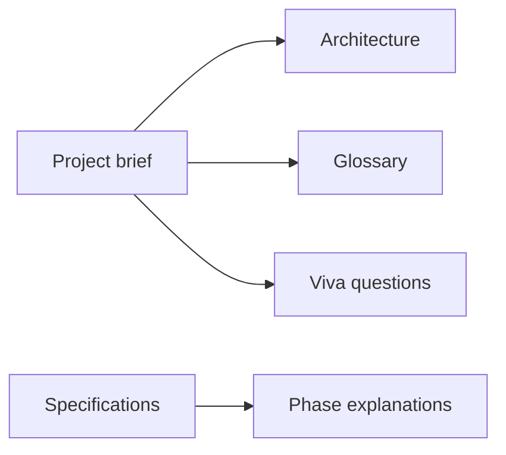

<!-- Purpose: explains the learning-document folder. Connects: glossary, viva answers, phase explanations, and project brief. -->
# Documentation

This folder holds the source brief and beginner-facing explanations.

