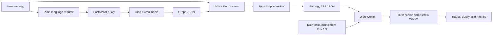

<!-- Purpose: explains AlgoTrace's runtime architecture in beginner-friendly terms. Connects: browser, compiler, WebAssembly engine, API, and frozen data. -->
# AlgoTrace architecture

The browser owns the strategy canvas, validation, and backtest execution. FastAPI only serves frozen price files and proxies AI requests so the model key stays on the server.

## Data path

1. The user draws a strategy or asks the AI to propose one.
2. The AI response is a graph proposal, which is displayed on the canvas.
3. The TypeScript compiler checks graph connections, types, and cycles, then emits the versioned Strategy AST.
4. The browser loads one instrument's daily bars and passes the AST and arrays to the Rust WebAssembly engine in a worker.
5. The engine returns trades, equity, and metrics for the results screens.

The API does not execute backtests. This keeps the user's strategy computation on the user's device.

