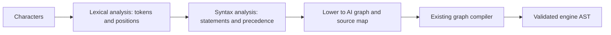

<!-- Purpose: explains the strategy-language frontend and its checks. Connects: plain text strategies to the compiler's graph and engine AST. -->
# Phase 7: Strategy language

## What it adds

Users can write a small strategy in plain text. `compileSource(source, config)` returns the same success or failure shape as the graph compiler, plus the generated graph and a source map. It does not add parser dependencies or change the Rust engine.

## The three analysis steps

The lexer recognizes identifiers, numbers, title strings, punctuation, and comments. It treats CRLF and LF as the same line break, supports files without a final newline, counts tabs as one column, and ignores `#` comments except inside a quoted title. Source locations are 1-based and spans end immediately after the final character.

The parser reads each line as a title, assignment, trading rule, or setting. After the optional first-line title, these statements may be interleaved. Names are assigned once and before use; there must be one buy and one sell rule. Settings are optional and each may appear once. A fixed precedence table groups `or`, `and`, `not`, comparisons, arithmetic, unary minus, and calls. Comparison chaining is rejected.

Graph lowering shares a PRICE node for each used field, creates CONSTANT nodes for numeric literals, and maps supported functions and operators to existing node types. Unary minus becomes subtraction from zero. Each emitted node gets a source span. If the graph compiler reports an error for a node, `compileSource` includes its source line and column so a text editor can highlight it.

## Tests

Tests cover all six AT-S codes, exact source locations, the three reference programs, newline and comment behavior, statement ordering, source-map translation of a graph type error, deterministic output, and fast-check generated text/programs. The real-WASM integration compiles each reference `.strategy` file and checks the RELIANCE.NS and TCS.NS trade counts against the recorded vectorbt comparison.

Implementation notes are in [`compiler/src/language/README.md`](../compiler/src/language/README.md). The grammar and mapping are defined in [`/spec/strategy-language.md`](../spec/strategy-language.md); decisions 041–044 record the parser, language design, source map, and unary-minus mapping.
