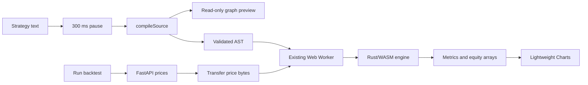

<!-- Purpose: explains the code-first Strategy Studio and its browser flow. Connects: the strategy language, compiler, data API, worker, and results chart. -->
# Phase 8: Strategy Studio

## What it adds

The app now opens on Strategy Studio. A user can load one of the three checked-in strategies, edit the source in a plain textarea, see compiler feedback at the source line, and run it against frozen prices. The existing visual canvas and quick demo remain available in their navigation tabs.

The toolbar uses RELIANCE.NS, the full available history, Rs 1,00,000 starting capital, and Indian delivery charges by default. The charges switch selects the bundled Zerodha delivery preset or `zero_costs`. The page sets slippage to zero because there is no slippage control and the reference comparison uses zero slippage. The NIFTY 50 index appears in the symbol selector as well.

## How the page is connected

The API supplies the selected symbol's AGT1 bytes. The browser transfers that buffer to the existing worker, which writes the data once into WASM memory. The existing wasm client then runs the AST and transfers the result arrays back to the page. The page uses the existing Lightweight Charts component for the equity curve.

## Editor and diagnostics

The editor uses a normal textarea, a synchronized line-number gutter, and the compiler's source locations. It compiles after 300 ms without typing. Clicking a diagnostic moves the caret to its line. Draft text is remembered in local storage; `.strategy` files can be opened or saved with browser file APIs. Ctrl+Enter starts a run.

The Graph tab reuses the existing node cards and dagre layout. It is read-only: code remains the single editable source. If the compiler returns an error, the graph preview stays safe and displays a plain message that the picture may be incomplete until the code is fixed. When a source-mapped diagnostic identifies a node, that node is highlighted.

## Browser proof

The local Playwright run starts FastAPI and Vite. Its first flow verifies the default Strategy Studio navigation, both navigation alternatives, the Run backtest button, and the Graph and Results tabs; it then runs the moving-average example on RELIANCE.NS with charges switched off and compares the result with the checked-in reference. The second flow introduces an unknown name on line 4, confirms the friendly source message and safe graph preview, repairs the name, and verifies that the graph renders nodes.

`pnpm test:e2e` is intentionally a local-only acceptance command, like the earlier browser workflows. The test expects 78 closed trades: the reference's 79 trade records include one final position that remains open.

## Decisions and trade-offs

- [Decision 047](../decisions/047-strategy-studio-code-source.md): code is editable and the generated graph is read-only.
- [Decision 048](../decisions/048-plain-textarea-editor.md): use a regular textarea and existing browser features rather than adding an editor package.
- [Decision 049](../decisions/049-strategy-studio-defaults.md): set the first-run defaults and zero slippage for reference parity.

The plain editor has no syntax highlighting or completion. This keeps the page small while preserving useful source locations and compiling through the existing compiler.
