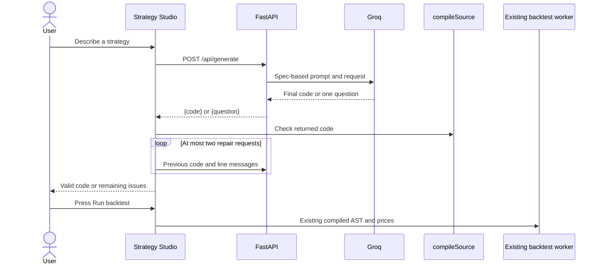

<!-- Purpose: explains the AI writing assistant and its compiler review boundary. Connects: a sentence to checked source while leaving simulation under the user's control. -->
# Phase 9: AI strategy assistant

## What it adds

Strategy Studio now has an Assistant panel above the code editor. A user can describe a trading rule, receive source code or a clarifying question, and inspect compiler feedback. The assistant does not run a backtest. The user reviews the code and presses the existing Run backtest button themselves.

The panel shows four example requests and the privacy note: “Your sentence is sent to the AI provider (Groq). The backtest itself runs on your computer.” The API key stays in the ignored `api/.env`; the browser calls only the local FastAPI route.

## How the flow works

The API reads the complete `/spec/strategy-language.md` at runtime and includes the three checked-in strategy programs plus an example using names with `and` and `or`. That way the model instructions track the project's actual syntax, allowed functions, and parameter ranges. The request is sent to Groq's chat-completions endpoint with the model taken from `GROQ_MODEL`; the endpoint uses low reasoning effort and asks the GPT-OSS models to exclude reasoning. The code reads only final message content and does not record provider reasoning or credentials.

The endpoint uses a 20-second provider timeout and an in-memory limit of 20 requests per client per minute. An unavailable key/model or provider returns a friendly 503. The browser offers Offline demo mode, with exactly five fixed sentences mapped to compiler-tested programs. It makes no AI call and labels the answer “from a built-in example, not from the AI.”

## Everyday analogy

Think of the assistant as a student who drafts a recipe. The compiler is the recipe checker: it points out steps that do not make sense. The person still reads the recipe and chooses whether to cook it; the assistant cannot turn on the stove by itself.

## Decisions and trade-offs

- [Decision 050](../decisions/050-groq-direct-http-and-env.md): call Groq directly and keep credentials in local environment settings.
- [Decision 051](../decisions/051-compile-before-user-run.md): compile generated source, repair it at most twice, and leave Run to the user.
- [Decision 052](../decisions/052-fixed-offline-assistant-demo.md): offer a clearly labeled five-answer offline demonstration.

This assistant does not guarantee that a strategy is profitable or sensible. The compiler checks language structure and types; the user remains responsible for reviewing the trading idea.

## Explain it in one minute

The user writes a sentence and FastAPI sends it to the configurable Groq model. The system prompt includes the strategy-language spec itself, so the AI sees the current syntax instead of a copied grammar. The assistant returns only source code or one question. AlgoTrace places any source in the editor, checks it with the compiler, and asks for at most two repairs using the line messages. If it still fails, the user can fix the listed lines manually. The assistant never runs a backtest: only the user can press Run. If Groq is unavailable, five fixed examples work offline and are labeled as built-in answers, not AI output.
