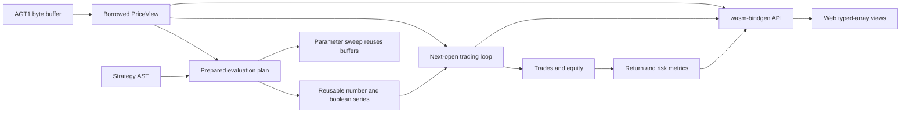

<!-- Purpose: documents the Rust backtesting engine. Connects: Strategy AST and daily bars to trades and metrics. -->
# Engine

The Rust crate executes a validated strategy over one instrument's daily bars. Its `wasm_api` module exposes pointer-based browser calls, while the native engine modules remain reusable as ordinary Rust code.

The web wrapper copies AGT1 bytes into reserved WebAssembly memory one time. The Rust loader then reads those bytes in place without creating a second copy of the encoded price file. JavaScript must build fresh typed-array views after calls that may grow WebAssembly memory.

