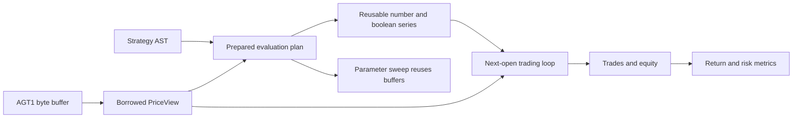

<!-- Purpose: documents the Rust backtesting engine. Connects: Strategy AST and daily bars to trades and metrics. -->
# Engine

The pure-Rust crate executes a validated strategy over one instrument's daily bars. This phase has no WebAssembly bindings or browser worker integration.

