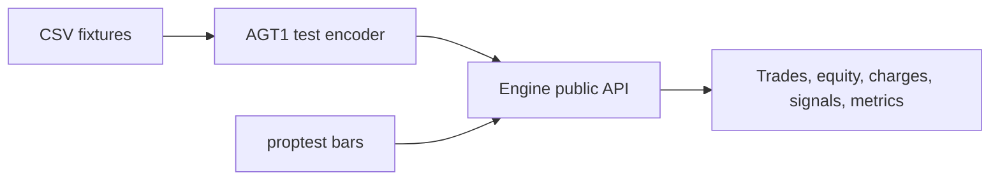

<!-- Purpose: documents engine integration tests and fixture data. Connects: hand calculations and randomized cases to public engine behavior. -->
# Engine tests

Integration tests exercise the public API with small, hand-checkable CSV fixtures and property-generated price series.

