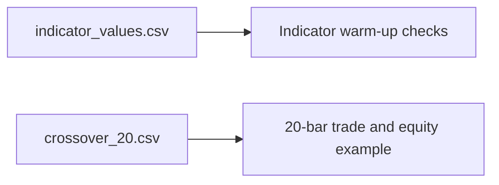

<!-- Purpose: explains the hand-computed engine fixtures. Connects: readable CSV values to integration test expectations. -->
# Test fixtures

Each CSV begins with a comment line, followed by named columns. Values are intentionally small enough to verify by hand.

