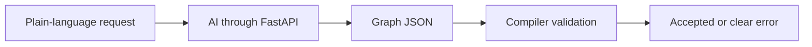

<!-- Purpose: documents AI sentence-to-graph evaluation. Connects: example requests to compiler validation outcomes. -->
# AI evaluation

This folder will contain example sentences and a runner for checking generated graphs.

