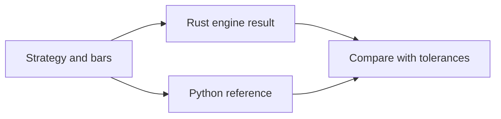

<!-- Purpose: documents independent Python reference calculations. Connects: strategy fixtures to comparison results. -->
# Reference calculations

This module compares three spec-defined strategies in vectorbt with results from the real Rust/WASM engine on frozen AGT1 price files. The comparisons use no costs or slippage. `compare_vectorbt.py` uses the spec's SMA, Wilder RSI, crossover, and price-comparison formulas to create signals; those arrays are passed to vectorbt while the corresponding AST makes Rust evaluate the same definitions independently.

## Reproduce the full-history comparisons

From the repository root in Windows PowerShell, build the generated WASM package, then run all three strategies on RELIANCE.NS, TCS.NS and SBIN.NS:

```powershell
pnpm build:wasm
reference\.venv\Scripts\python.exe reference\scripts\compare_vectorbt.py --symbols RELIANCE.NS,TCS.NS,SBIN.NS
reference\.venv\Scripts\python.exe -m pytest reference\tests -q
```

Python 3.13.6, pandas 3.1.1 and vectorbt 1.2.1 were verified in the local reference venv. The vectorbt settings are: `init_cash=100000`, `size=1.0`, `size_type=percent`, `size_granularity=1.0` share, `allow_partial=True`, `cash_sharing=False`, `direction=longonly`, `accumulate=False`, `upon_long_conflict=Ignore`, `price=open`, entry and exit signals shifted one bar, `fees=0`, `fixed_fees=0`, `slippage=0`, and `force_close_at_end=False` (the open trade remains open). `use_stops=False` except for the stop strategy. That strategy additionally uses `sl_stop=0.10`, entry price `FillPrice`, and stop exit `StopMarket`. Rust receives the same initial capital, 100% position size, zero slippage, zero-valued cost preset, stop percentage where applicable, and the spec's open-position-at-end behavior.

Comparisons require exact entry/exit dates and share counts. Trade prices and every daily equity value use a strict `1e-6` relative tolerance. The runner prints `PASS` or the first unexcepted difference per pair and exits nonzero for any such difference; do not raise the tolerance to mask a difference. For the named SBIN stop-precedence exception, it compares through bar 2501 and reports the observed difference at bar 2502, without comparing later trades or equity for that case. The exception is reported separately and does not count as an unexcepted failure.

## Current result and known difference

Eight strategy/instrument pairs match over their complete histories. The SMA(10)/SMA(30) crossover and RSI(14) cross-below-30/cross-above-70 strategies match on all three stocks. The close-above/below-SMA(20) strategy with a 10% stop matches for RELIANCE.NS and TCS.NS. The SBIN.NS stop strategy is compared through bar 2501 and stops at the named exception on bar 2502 (2020-03-02): a scheduled signal exit is due at the open, and that bar's low also crosses the stop. Rust exits at the open (Rs 281.8838663839738); vectorbt's built-in stop processing exits at Rs 262.91332104510093. Close equity is Rs 228917.01286380854 in Rust and Rs 213512.9300486438 in vectorbt. An experiment setting a per-bar `sl_stop` array to `NaN` on scheduled-exit bars did not change vectorbt's stop fill. No custom callback was added. Accepted rule G15 and the named exception are recorded in [decision 028](../decisions/028-vectorbt-stop-order-precedence.md). Engine code was not changed.



