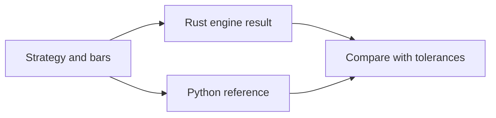

<!-- Purpose: documents independent Python reference calculations. Connects: strategy fixtures to comparison results. -->
# Reference calculations

This module will compare selected engine results with pandas and vectorbt and a Zerodha-style charges calculator.

