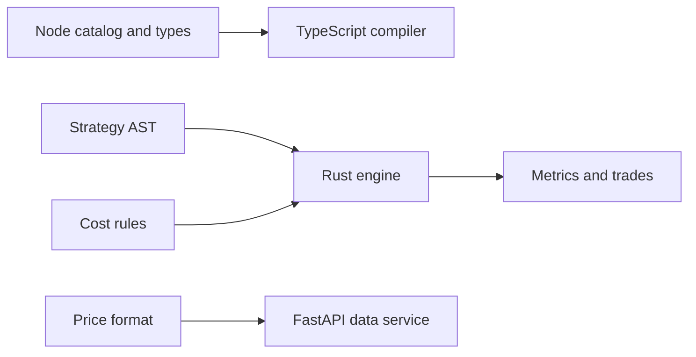

<!-- Purpose: explains where normative project behavior is defined. Connects: compiler, engine, API, and UI. -->
# Specifications

Files here define the formats and behavior that implementations must follow.

