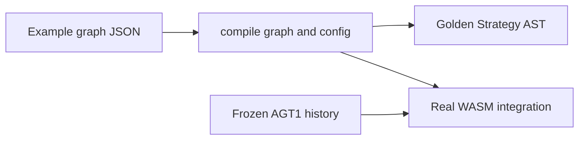

<!-- Purpose: indexes compiler example graphs and their golden AST output. Connects: graph rules to compiler tests and the Rust/WASM integration. -->
# Compiler examples

The three strategy graphs mirror `reference/scripts/compare_vectorbt.py`: SMA(10)/SMA(30) crossover, RSI(14) crossing below 30 and above 70, and close above/below SMA(20) with a 10% stop. Each has a matching `.ast.json` golden file. The invalid graph fixtures each target one compiler code from AT-E001 through AT-E010; `unreachable-warning.json` targets AT-W001.

JSON does not support comments, so these data fixtures are documented here and in their adjacent project decisions.

