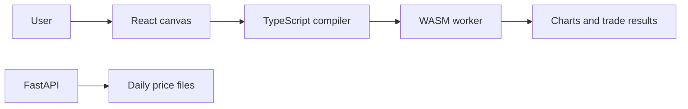

<!-- Purpose: documents the browser application. Connects: the user canvas and results view to compiler and API. -->
# Web application

This workspace package will host the React Flow canvas, compiler integration, and backtest results screens.

