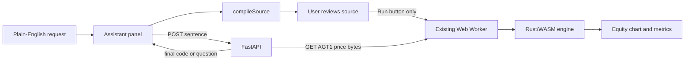

<!-- Purpose: documents the React Strategy Studio and local backtest flow. Connects: assistant, language compiler, FastAPI, worker-owned WASM, and results. -->
# Web application

The root page opens on Strategy Studio. A user may describe a strategy to the optional Groq assistant, load a checked-in source example, or edit the language code directly. Generated source always passes through `compileSource`; the Assistant never starts a backtest. The generated graph is read-only. The Visual canvas (advanced) and Quick demo remain separate navigation tabs.



The API settings are `GROQ_API_KEY` and `GROQ_MODEL` in the ignored `api/.env`. If the provider is unavailable, the assistant offers its five-sentence Offline demo mode; these are fixed examples, not AI-generated responses. The normal Examples dropdown always remains available. See [`src/studio/README.md`](src/studio/README.md) for component responsibilities and [`docs/phase-9-explained.md`](../docs/phase-9-explained.md) for the full flow.

## Start the app (Windows PowerShell)

Terminal 1, from the repository root:

```powershell
api\.venv\Scripts\python.exe -m uvicorn app.main:app --app-dir api --host 127.0.0.1 --port 8000
```

Terminal 2, from the repository root:

```powershell
pnpm --filter @algotrace/web dev -- --host 127.0.0.1
```

Open `http://127.0.0.1:5173`. The API address is read from `VITE_API_URL`, defaulting to `http://127.0.0.1:8000`.

## Tests

The browser checks use mocked `/api/generate` replies. No automated test calls the real Groq provider.

```powershell
pnpm --filter @algotrace/web test
pnpm --filter @algotrace/web typecheck
pnpm --filter @algotrace/web test:wasm
pnpm --filter @algotrace/web test:e2e
```
