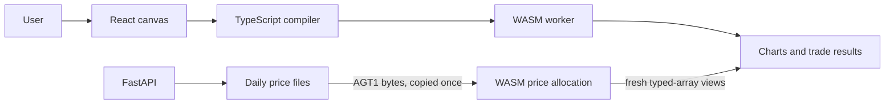

<!-- Purpose: documents the browser application. Connects: the user canvas and results view to compiler and API. -->
# Web application

This workspace package hosts the React app and a typed wrapper for the wasm-bindgen engine API. The wrapper expects an initialized generated WASM module; wiring the module into a worker and results screen is still pending.

