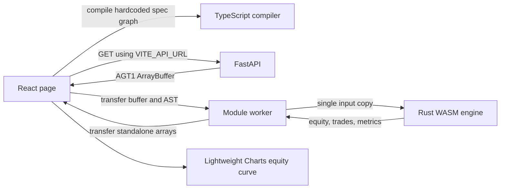

<!-- Purpose: documents the React thin-slice app and local run flow. Connects: FastAPI data, the graph compiler, worker-owned WASM, and result chart. -->
# Web application

The root page runs one strategy: the `/spec/examples/sma_crossover.json` SMA(10)/SMA(30) graph on the complete frozen RELIANCE.NS history. The graph is compiled by `@algotrace/compiler`. The API returns AGT1 bytes; the page transfers the ArrayBuffer to a dedicated worker, which copies the bytes into WASM once and runs the compiled AST. The worker transfers standalone equity, trade, timestamp, and metric arrays back for display.



## Start the demo (Windows PowerShell)

Terminal 1, from the repository root:

```powershell
api\.venv\Scripts\python.exe -m uvicorn app.main:app --app-dir api --host 127.0.0.1 --port 8000
```

Terminal 2, from the repository root (this builds the ignored WASM package before starting Vite):

```powershell
pnpm --filter @algotrace/web dev:demo
```

Open `http://127.0.0.1:5173`. The page uses `VITE_API_URL`, defaulting to `http://127.0.0.1:8000`. Add an override to the root `.env` if the API uses a different local address. `.env.example` contains the variable name and default.

On first load the worker initializes WASM, performs one startup run, then performs the display run. The page shows the second WASM time separately from the first startup time and total time including the data fetch. The Indian-charges checkbox switches from `zero_costs` to `zerodha_equity_delivery`, fetches and compiles again, and reruns the strategy.

The Playwright test starts FastAPI and Vite itself and checks the actual browser's CORS access, 4,160 daily data bars, equity curve, final equity against the reference JSON, and the reference trade counts. It is local-only for now; CI does not run it.

```powershell
pnpm --filter @algotrace/web test:e2e
```
