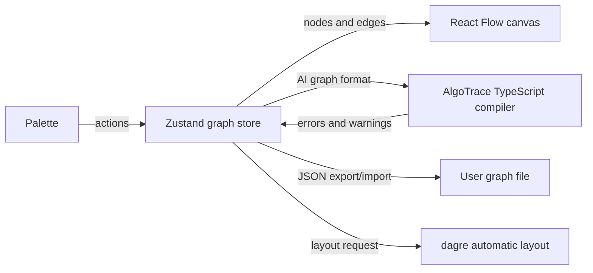

<!-- Purpose: explains the strategy canvas modules and their data flow. Connects: Zustand graph state, React Flow, compiler diagnostics, and file templates. -->
# Strategy canvas

The canvas stores compiler graph data in the same `{ nodes, edges }` format as `/spec/ai-graph-format.md`; screen positions remain React Flow state and are never passed into the compiler. The compiler package's `canvas-rules` subpath checks proposed wires by running the compiler's own validation and type pass.

`store.ts` owns graph edits and undo history. `StrategyCanvas.tsx` connects toolbar and palette actions to the store. `CanvasNode.tsx` renders every catalog operation and the parameter controls. `graphFiles.ts` handles the three checked-in strategy templates and the intentionally invalid compiler examples.
