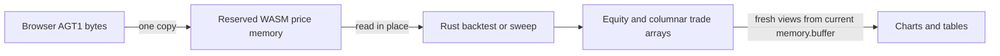

<!-- Purpose: documents the browser-to-WASM memory contract. Connects: Vite web code to the Rust engine exports. -->
# Browser engine wrapper

`wasmClient.ts` wraps the wasm-bindgen module after its generated initializer has completed. The web app gives it an AGT1 byte array and compiled AST JSON; it copies the price bytes into WASM once, and Rust reads them in place for each backtest or sweep.



Never retain an array view across a WASM call that may grow memory. `runBacktest()` returns fresh views after its call; `runSweep()` returns fresh views alongside the sweep points. Open-trade exit fields use `NaN`; the exit reason codes are 0 for open, 1 signal, 2 stop loss, 3 take profit, and 4 end of data.

## Visible worked example
Build the generated module with `pnpm build:wasm`, then start Vite from the repository root:

```powershell
pnpm --filter @algotrace/web dev --host 127.0.0.1
```

Open `http://127.0.0.1:5173/src/engine/wasm-test.html`. The page reads `engine/tests/fixtures/crossover_20.csv` and displays final equity, closed-trade count, and total charges after the real WASM run.
