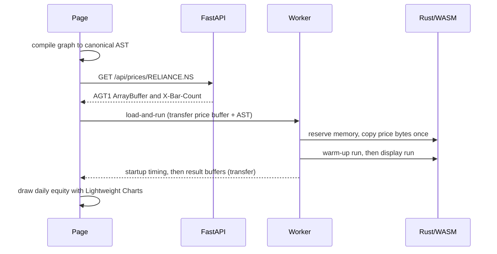

<!-- Purpose: documents the browser-to-WASM memory contract. Connects: Vite web code to the Rust engine exports. -->
# Browser engine wrapper

`wasmClient.ts` wraps the wasm-bindgen module after its generated initializer has completed. The web app gives it an AGT1 byte array and compiled AST JSON; it copies the price bytes into WASM once, and Rust reads them in place for each backtest or sweep.

```mermaid
flowchart LR
  API[FastAPI binary response] -->|transfer ArrayBuffer, no structured clone| Worker[Dedicated Web Worker]
  Worker -->|one copy into WASM| Bytes[Reserved WASM price memory]
  Bytes -->|read in place| Rust[Rust backtest or sweep]
  Rust -->|fresh views from current memory.buffer| ResultCopy[Owned result arrays]
  ResultCopy -->|transfer ArrayBuffers| UI[React page and Lightweight Charts]
```



Never retain an array view across a WASM call that may grow memory. `runBacktest()` returns fresh views after its call; `runSweep()` returns fresh views alongside the sweep points. Open-trade exit fields use `NaN`; the exit reason codes are 0 for open, 1 signal, 2 stop loss, 3 take profit, and 4 end of data.

## Visible worked example
Build the generated module with `pnpm build:wasm`, then start Vite from the repository root:

```powershell
pnpm --filter @algotrace/web dev --host 127.0.0.1
```

Open `http://127.0.0.1:5173/src/engine/wasm-test.html`. The page reads `engine/tests/fixtures/crossover_20.csv` and displays final equity, closed-trade count, and total charges after the real WASM run.

## Typed page/worker protocol

`backtestProtocol.ts` owns the request and response types. The page compiles the checked-in SMA(10)/SMA(30) graph, fetches `RELIANCE.NS` from `VITE_API_URL` (default `http://127.0.0.1:8000`), checks the exposed `X-Bar-Count` header, and transfers the original API `ArrayBuffer` with `postMessage`'s transfer list.



The `load-and-run` request carries the run id, AGT1 buffer, compiled AST JSON, and whether to do a warm-up run. A `warmup-complete` response reports the first run time including WASM initialization. The following `result` response transfers timestamps, equity, each trade column, numeric metric values, and a metric-validity byte array. The validity bytes preserve spec-defined `null` metrics without putting NaN in the UI data. The worker copies result columns out of WASM memory before transferring them, then frees the engine's result allocation. `error` responses contain readable worker errors.

The initial page load runs the engine twice against one WASM price allocation; the UI displays both the startup run time and the second run time. The total elapsed time begins before the API fetch and ends after the second worker response. Changing the Indian-charges checkbox fetches the same history again, recompiles with `zerodha_equity_delivery`, and runs the engine once; it does not repeat the cold-start run. The worker is terminated when React unmounts the page.

## Run the focused Playwright browser check

The browser test starts FastAPI and Vite using Playwright's `webServer` setting. It is intentionally local-only and is not run in CI while it depends on a local Python environment and frozen data.

```powershell
pnpm --filter @algotrace/web test:e2e
```

Download the approved Chromium test browser once if needed:

```powershell
pnpm --filter @algotrace/web exec playwright install chromium
```
