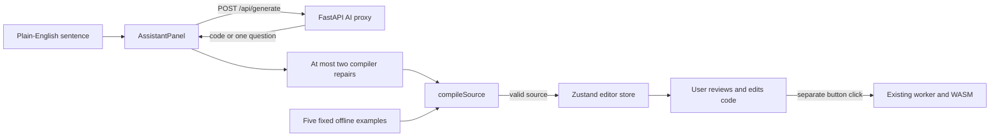

<!-- Purpose: documents the Strategy Studio feature modules. Connects: source editing, AI writing, compiler checks, and user-run backtests. -->
# Strategy Studio modules

`AssistantPanel.tsx` shows four sample requests, privacy wording, assistant states, clarifying questions, compiler feedback, and the clearly labeled offline mode. It updates the existing editor store but never invokes the backtest function. `assistantClient.ts` contains the tested request and bounded repair loop. `offlineExamples.ts` has exactly five fixed sentence/code pairs, all tested through the existing compiler. `store.ts` remembers editor code and the pre-assistant source for Undo.

The Assistant endpoint is configurable through the Studio's existing `VITE_API_URL`. A provider/network failure leaves the normal Examples dropdown available and offers offline mode. The offline demo accepts only its fixed sentences and identifies each output as built in, not AI generated.
